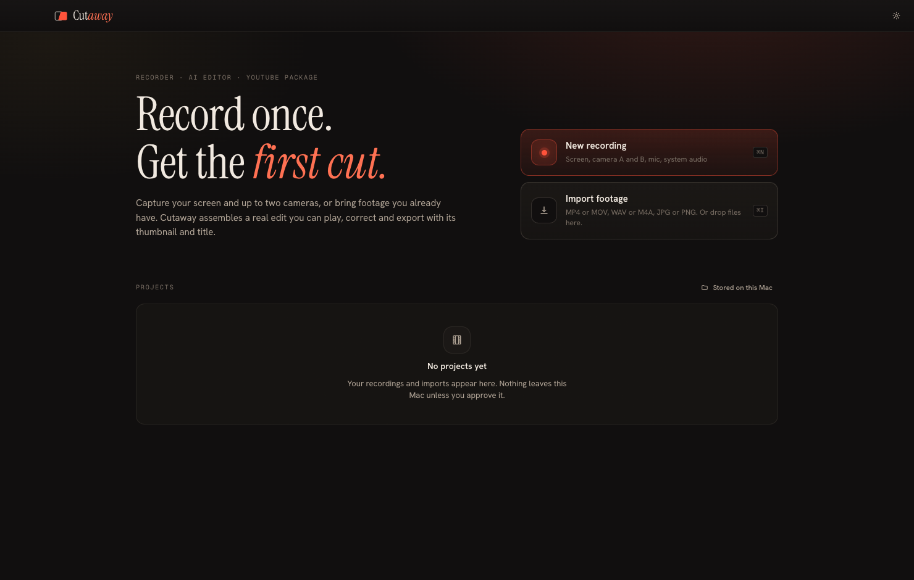
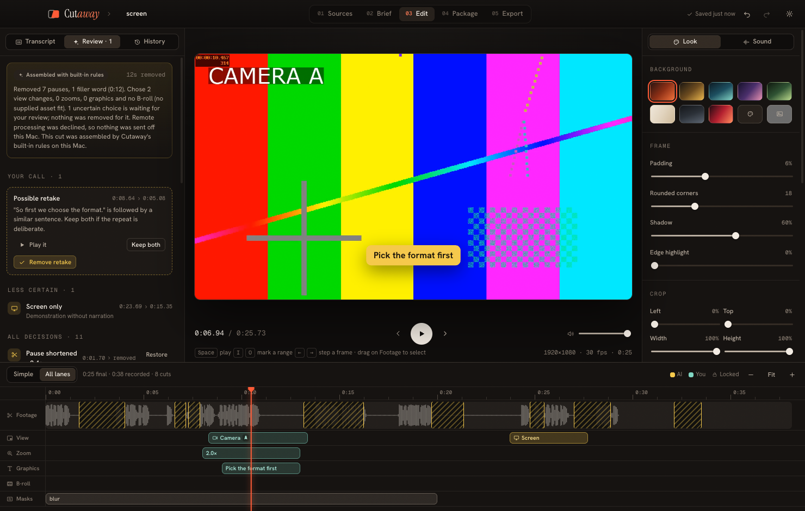
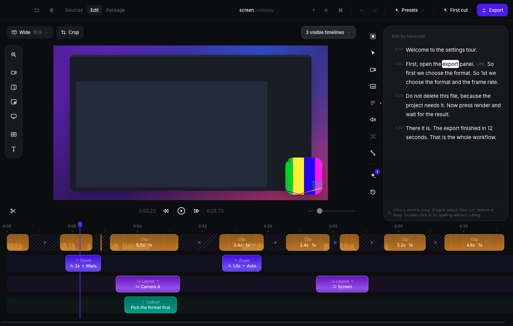
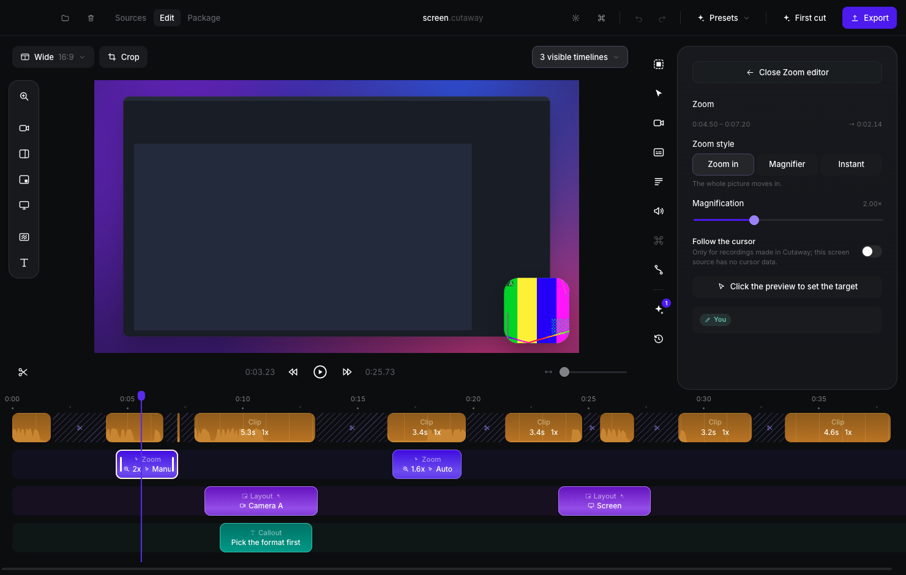
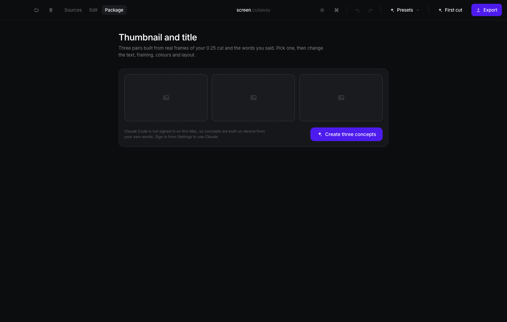

# Cutaway

**Record once. Get the first cut.**

Cutaway is a macOS recorder and editor for solo YouTube creators. It captures
your screen and up to two cameras (or imports footage you already have),
assembles a real, playable first cut, lets you correct it by text, timeline or
plain-language request, and exports one folder with the video, thumbnail,
title, captions and chapters.

It is an independent build with its own name, icons, artwork and code. Its
layout and controls deliberately follow Screen Studio's editor, studied from
public documentation and screenshots; it contains no Screen Studio code or
assets and does not read Screen Studio projects.

## Run it

Requirements: Apple silicon Mac, macOS 14 or later (built and tested on macOS
26.5), Xcode command line tools (Swift 6), Node 22, pnpm 9.

```bash
pnpm install
pnpm dev          # builds the native helper, then starts the app with hot reload
```

Build a standalone app:

```bash
pnpm package      # → apps/desktop/release/mac-arm64/Cutaway.app
```

`pnpm package` finishes by signing the app and its capture helper. Name a
code-signing identity from your keychain in `CUTAWAY_SIGN_IDENTITY`, or in
`apps/desktop/.signing.local.json` as `{"identity": "<name or SHA-1>"}` (that
file is ignored by git). With an identity, macOS keeps the app's Screen
Recording, Camera and Microphone permissions across rebuilds. Without one the
build is ad-hoc signed and macOS treats every rebuild as a new app.

The first recording asks macOS for Screen Recording, Camera and Microphone
permission, one source at a time and only for the sources you switch on.

**Screen recording permission.** Press **Allow…** on the recorder. macOS shows
its prompt once and adds the app to System Settings → Privacy & Security →
Screen & System Audio Recording; switch it on there and come back (the
recorder notices without a restart). The entry is "Cutaway" for the packaged
app, and the terminal or editor you ran `pnpm dev` from in development.

### Recording

* **What to record:** a display, one window, an area, one **browser tab**, an
  iPhone or iPad screen, or the camera alone. Tab mode records the browser
  window with its tab strip and toolbar left out, so only the page is in the
  video. Listing tabs needs macOS's Automation permission for that browser;
  measuring the page area exactly needs Accessibility, and without it a
  per-browser estimate is used with a "Trim top" field to adjust.
* **Layout:** Screen + bubble, Side by side, Camera + screen, Screen only or
  Camera only, chosen before recording and editable afterwards.
* **Countdown** appears over the display that holds the target, with the
  target outlined, not inside the Cutaway window.
* **Self-view:** while a take has a camera, a small floating bubble shows the
  camera as it is being recorded. Drag it, resize it, or hide it from the
  recording controls. It is never part of the recording.
* **iPhone as a camera:** uses Apple's Continuity Camera. Same Apple Account on
  both devices, Wi-Fi and Bluetooth on, iPhone locked and near the Mac (or on a
  mount, or plugged in by USB). It then appears in the Camera A and Camera B
  menus labelled "iPhone". Pick the Mac's camera for A and the iPhone for B to
  record two angles.

### AI features use your own Claude Code or Codex

Cutaway has no API key and no server. The editorial pass, the "Ask AI" chat
and the thumbnail/title concepts run through a command-line tool **already
installed on your Mac**, using your existing sign-in: the Claude Code CLI
(`claude`) or the Codex CLI (`codex`). Choose which in Settings → AI.

Cutaway finds and runs the tool through your login shell, so it is the same
command, PATH and environment as your terminal. If the tool says you are not
logged in, so does Cutaway: choose **Sign in…** in Settings or on the brief
screen (it opens Terminal on the tool's own login command), or run it yourself:

```bash
claude auth login
```

```bash
codex login
```

**Generated pictures** for thumbnails always go through Codex, because only
Codex has an image tool. They are asked for one at a time, with their own
consent sheet, even when Claude does the editing.

**Ask AI** (the chat tab in the editor, ⌘9) proposes specific edits as cards
you apply one at a time. Every applied card becomes a named version. Click any
version in History, or "View this version" in the chat, to look at the video
as it was at that point, read-only, and then go back to latest or restore it.

**Playbooks.** The prompts carry written guidance on pacing and cuts, titles
and thumbnails (Settings → Playbooks shows them and takes your own notes), and
the Package screen warns about weak titles and thumbnails.

Be clear about what that means: the model does not run on your Mac. When you
allow it (per project and per tool, with an explicit sheet), Cutaway hands the
tool the transcript text, edit metadata and a few still frames, and the tool
sends them to Anthropic or OpenAI. Video and audio files never leave the Mac.
Transcription, pause and filler cleanup, sync, preview and export are always
on-device. Decline the sheet, or stay signed out, and Cutaway assembles the
cut with its built-in rules instead.

## Repository

```
apps/desktop      Electron app: main process, preload bridge, React renderer
  src/main          project library, native bridge, export file handling, Claude Code and Codex bridge
  src/renderer      screens, editor, compositor, preview player, exporter, jobs
  e2e               end-to-end scripts that drive the real app (Playwright + Electron)
packages/core     project model, time mapping, sync maths, edit validation, captions, preflight
packages/ai       prompts, playbooks, schemas and the local Claude Code and Codex runners
native            Swift helper `cutaway-native`: capture, probe, stills, on-device speech, mux
fixtures          script that generates deterministic test footage (nothing is checked in)
docs              engineering report, native protocol, the product package (docs/prd)
```

Start with [docs/ENGINEERING_REPORT.md](docs/ENGINEERING_REPORT.md): how it is
built, what was measured, what is not finished, and the decisions that are
still yours.

## Tests

```bash
pnpm test                               # 211 unit tests (core, AI layer, desktop)
./fixtures/make.sh                      # generate test footage (needs ffmpeg + say)
pnpm --filter @cutaway/desktop build
pnpm --filter @cutaway/desktop e2e      # journeys through the real app and helper
node apps/desktop/e2e/recorder.mjs      # layouts, countdown overlay, self-view, tab mode, window crop
pnpm --filter @cutaway/desktop e2e:real # records your real screen for 7 s (needs permission)
node apps/desktop/e2e/claude-real.mjs   # the AI pass through your signed-in Claude Code (uses your account)
node apps/desktop/e2e/codex-real.mjs    # the same through Codex, plus one generated picture (uses your account)
node apps/desktop/e2e/chat-real.mjs     # two chat requests through Claude Code (uses your account)
```

Every other end-to-end run sets `CUTAWAY_CLAUDE=off` and `CUTAWAY_CODEX=off`,
so tests never call a model or depend on your sign-in. `recorder.mjs` opens
real windows on your screen and records a few seconds of a test window.

The end-to-end scripts launch the built app against a throwaway profile, so
they never touch your real projects.

## Where your work lives

Projects are folders in `~/Movies/Cutaway/<name>.cutaway` (project file,
recorded media, replaceable caches, rolling backups). Exports go to
`~/Movies/Cutaway Exports`. Removing a project moves only that folder to the
Trash; files you imported by reference are never touched. Nothing is uploaded
to YouTube.

## Screens

Captured from the running app with generated test footage.







