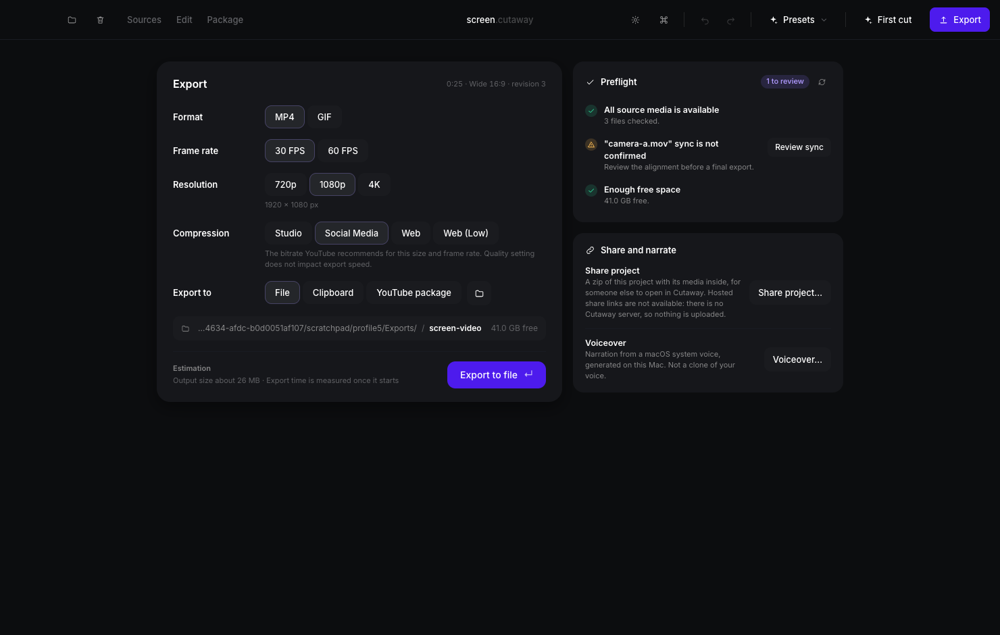

# Cutaway

**Record once. Get the first cut.**

Cutaway is a macOS recorder and editor for solo YouTube creators. It captures
your screen and up to two cameras (or imports footage you already have),
assembles a real, playable first cut, lets you correct it by text, timeline or
plain-language request, and exports one folder with the video, thumbnail,
title, captions and chapters.

It is an independent build with its own name, icons, artwork and code. Its
layout and controls deliberately follow Screen Studio's editor, studied from
public documentation and screenshots; it contains no Screen Studio code or
assets and does not read Screen Studio projects.

## Run it

Requirements: Apple silicon Mac, macOS 14 or later (built and tested on macOS
26.5), Xcode command line tools (Swift 6), Node 22, pnpm 9.

```bash
pnpm install
pnpm dev          # builds the native helper, then starts the app with hot reload
```

Build a standalone app (ad-hoc signed, for this Mac):

```bash
pnpm package      # → apps/desktop/release/mac-arm64/Cutaway.app
```

The first recording asks macOS for Screen Recording, Camera and Microphone
permission, one source at a time and only for the sources you switch on. In
`pnpm dev` macOS shows the app as "Electron"; the packaged app shows as
"Cutaway".

### AI features use your own Claude Code

Cutaway has no API key and no server. The editorial pass and the
thumbnail/title concepts run through the **Claude Code CLI already installed
on your Mac**, using your existing sign-in:

```bash
claude            # then type /login once
```

Be clear about what that means: the model does not run on your Mac. When you
allow it (per project, with an explicit sheet), Cutaway hands Claude Code the
transcript text, edit metadata and a few still frames, and Claude Code sends
them to Anthropic. Video and audio files never leave the Mac. Transcription,
pause and filler cleanup, sync, preview and export are always on-device.
Decline the sheet, or stay signed out, and Cutaway assembles the cut with its
built-in rules instead.

## Repository

```
apps/desktop      Electron app: main process, preload bridge, React renderer
  src/main          project library, native bridge, export file handling, Claude bridge
  src/renderer      screens, editor, compositor, preview player, exporter, jobs
  e2e               end-to-end scripts that drive the real app (Playwright + Electron)
packages/core     project model, time mapping, sync maths, edit validation, captions, preflight
packages/ai       prompts, schemas and the local Claude Code runner
native            Swift helper `cutaway-native`: capture, probe, stills, on-device speech, mux
fixtures          script that generates deterministic test footage (nothing is checked in)
docs              engineering report, native protocol, the product package (docs/prd)
```

Start with [docs/ENGINEERING_REPORT.md](docs/ENGINEERING_REPORT.md): how it is
built, what was measured, what is not finished, and the decisions that are
still yours.

## Tests

```bash
pnpm test                               # 91 unit tests (core, AI layer, jobs)
./fixtures/make.sh                      # generate test footage (needs ffmpeg + say)
pnpm --filter @cutaway/desktop build
pnpm --filter @cutaway/desktop e2e      # journeys through the real app and helper
pnpm --filter @cutaway/desktop e2e:real # records your real screen for 7 s (needs permission)
```

The end-to-end scripts launch the built app against a throwaway profile, so
they never touch your real projects.

## Where your work lives

Projects are folders in `~/Movies/Cutaway/<name>.cutaway` (project file,
recorded media, replaceable caches, rolling backups). Exports go to
`~/Movies/Cutaway Exports`. Removing a project moves only that folder to the
Trash; files you imported by reference are never touched. Nothing is uploaded
to YouTube.

## Screens

Captured from the running app with generated test footage.



